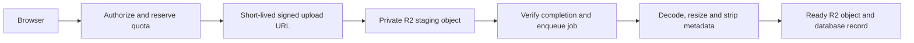

# Production architecture review — 30 October 2026

Scope: email/OTP, R2 uploads, background notifications, and their deployment requirements. The original review was documentation-only; the implementation follow-up below records later code changes. It assumes the Vercel + Supabase PostgreSQL deployment described in `NAIJASPA-LAUNCH-GUIDE.md`; a persistent worker host would change the queue recommendation.

Local Redis follow-up: the user chose local/self-hosted Redis. Standard `REDIS_URL` support is now implemented and the live atomic counter/rejection check passed against the existing WSL Redis server. Upstash REST remains optional. Deployment instances will need a securely reachable Redis URI for their own environment.

Implementation follow-up: the user authorized the first hardening stage. OTP challenge HMACs, persistent attempt/cooldown limits, atomic consumption, session revocation and stale-login protection are now implemented. The shared Redis limiter is integrated; live Redis setup was deferred by the user. Remaining review findings, including durable email/outbox delivery and upload hardening, remain open. Current behavior and operational steps: [AUTH-SECURITY.md](AUTH-SECURITY.md). The findings below describe the original review snapshot.

## Decision

Use PostgreSQL as the source of truth for OTP challenges and business records, shared Redis for abuse limits, and a durable job mechanism for email and reminders. Keep R2 as object storage. BullMQ is an option when there is a suitable worker runtime; uploading an image does not by itself require a queue.

The user chose local/self-hosted Redis. The next queue direction is a PostgreSQL transactional outbox plus BullMQ on a persistent worker host, once that runtime is provisioned. A Vercel-hosted app must connect to a securely reachable deployment Redis server; its localhost does not reach this development machine. Redis is BullMQ's default backend; current documentation also describes a PostgreSQL backend. Select and pin a compatible release after checking its requirements. A managed HTTP delivery service such as QStash remains an optional alternative, rather than a selected dependency. [BullMQ backends](https://docs.bullmq.io/guide/postgresql), [QStash](https://upstash.com/docs/qstash/overall/getstarted).

## Findings that should be addressed before production

| Priority | Finding and evidence | Required outcome |
|---|---|---|
| High | `src/lib/http.ts` stores rate limits in a process-local Map. Forgot/reset routes also use global keys such as `forgot` (8/minute), shared by every caller within that instance. | Shared atomic per-account and per-IP limits, resend cooldown, challenge attempt budget, bounded retention, and an explicit outage policy. Keep a provider-wide safety budget separate from ordinary user limits. |
| High | `src/app/api/auth/reset/route.ts` finds an unused OTP before the transaction. Both simultaneous requests can pass that read, and the later updates do not check that exactly one request consumed the challenge. Existing sessions are not revoked. | Claim an unused, unexpired challenge conditionally inside the password-change transaction, require one affected row, invalidate remaining challenges, and revoke existing sessions. |
| High | `src/lib/auth-reset.ts` uses SHA-256 of user ID plus a six-digit code. Random generation is cryptographically sound, but the low-entropy hash can be exhaustively guessed if the database is exposed. The schema has no persisted verification attempt budget. | Use a server-secret HMAC scoped to challenge ID, account and purpose; keep the secret outside the database. Add persisted failed-attempt limits and strict code validation. Redis expiration alone does not implement these guarantees. |
| High | `src/lib/mail.ts:queueMail` starts a Promise and catches its error; it does not persist a job. Registration, Google welcome messages, vendor invitations and subscription mail use it. | A committed job record, bounded retries/backoff, a terminal failure state, safe replay, and monitoring. Returning from a request must not lose the message. |
| High | `src/app/api/auth/forgot/route.ts` creates a challenge, waits for SMTP, catches delivery failure, then records a notification claiming an email was sent. Concurrent resend requests can create more than one active challenge. | Atomically supersede prior challenges and enqueue delivery. Preserve a generic account-existence response, track actual delivery state internally, and serialize resends. Expired/superseded jobs must not send stale codes. |
| High | File bytes pass through the application function. Gallery configuration permits up to 10 MiB while Vercel documents a 4.5 MB request/response payload limit. | Keep proxied uploads safely within platform limits or introduce authenticated direct R2 uploads. Moving work to a queue does not fix an oversized HTTP request. [Vercel limits](https://vercel.com/docs/functions/limitations). |
| Medium | Gallery/category handlers read `arrayBuffer()` before checking the configured byte limit. `detectImageMime` inspects signatures, rather than fully decoding an image. Gallery count checks can race across simultaneous uploads. | Early size rejection, request/stream limits where applicable, actual image decoding and pixel limits, metadata handling, and atomic quota reservation. Preserve the existing gallery design. |
| Medium | `vercel.json` schedules subscriptions only. The notification worker is currently a local interval process. Reminder scans consider a 15-minute window, take 100 rows, and dispatch at most four notifications per invocation. | A deployed scheduler/consumer, durable due dates and catch-up, fair batch selection, lease recovery, bounded concurrency and observable retry exhaustion. Check booking status before sending a reminder. |
| Medium | SMTP authentication succeeds, but the tested Gmail message reported SPF softfail. | The hosting/DNS administrator must authorize the actual relay. Queue retries and Redis do not correct SPF or guarantee Inbox placement. |

The current OTP endpoints implement **password reset**. Ordinary email/password registration creates a session without a separate email-verification challenge. If signup email verification is required, add a purpose-specific verification flow; Google-verified accounts are already marked verified by the Google flow. Keep verification and password-reset challenges separate.

The recommended reset controls align with [OWASP's password reset guidance](https://cheatsheetseries.owasp.org/cheatsheets/Forgot_Password_Cheat_Sheet.html): secure expiring single-use codes, abuse protection, consistent responses and session invalidation.

## Email and OTP flow

1. Apply shared account/IP rate limits and a resend cooldown. Keep a persisted per-challenge attempt cap even if Redis is unavailable. Define conservative behavior for auth requests during limiter outages.
2. In one PostgreSQL transaction, supersede the prior challenge, create the new challenge digest/expiry, and insert an outbox event with a stable deduplication key.
3. A dispatcher publishes committed outbox rows to the delivery service. Failed publishes remain retryable. A scheduled sweep recovers undispatched rows; a database commit followed by a queue publish alone has a failure gap.
4. A verified worker request claims the mail job, checks that its challenge is still current and unexpired, and sends the message. Give auth email separate priority/concurrency from bulk messages or media processing.
5. Store delivery attempts, next attempt time, provider acceptance/reference, and terminal failure. Use bounded exponential backoff and short deadlines suitable for OTP expiry. Provider acceptance and mailbox delivery are distinct events.
6. Verify the submitted code, atomically consume the challenge, change the password and revoke old sessions. Never log codes or reset secrets.

Queue payloads should contain job/challenge IDs rather than reusable secrets. If workers need the original OTP for retries, keep a short-lived encrypted mail payload with a separate managed encryption key, narrow access and deletion after expiry/completion. A digest cannot be converted back to the code. Reuse the same still-valid challenge for send retries rather than generating a new code on every attempt.

Use at-least-once delivery assumptions and idempotent handlers. A mail provider may accept a message before the worker loses its connection. Use provider idempotency where available; plain SMTP cannot promise exactly-once inbox delivery.

## Upload flow

For today's small images, a bounded synchronous upload can remain: authorize owner, reserve quota, reject excessive size, decode with pixel limits, store in R2, commit the media record, and return a ready image. Add compensation/reconciliation for failed database writes, failed deletes and abandoned uploads.

For larger files or substantial transformations:

The browser uploads directly to a server-chosen object key. Configure CORS for approved origins. Verify ownership, actual object size and decoded contents before publishing a usable image. A signed Content-Type header is not proof that the bytes are a valid image. Expire abandoned staging objects and release unused quota. Pass object IDs/keys to jobs, not binary image buffers. [R2 presigned URLs](https://developers.cloudflare.com/r2/api/s3/presigned-urls/).

Background media jobs become useful for resizing variants, format conversion, scanning/moderation, bulk imports and orphan cleanup. They are not needed merely to put a small file into R2. Serving every public gallery image through the Next.js proxy also routes image traffic through the app; evaluate a controlled CDN/Worker delivery path when traffic warrants it, keeping private originals protected.

## Worker deployment and operations

For Vercel, a managed HTTP delivery service is an alternative for bounded email and reminder jobs if the user later chooses one. Authenticate delivery callbacks and make replay safe. Keep PostgreSQL outbox/job state so a queue outage does not lose business intent. The current preference is self-hosted Redis and a separately hosted persistent worker. [QStash callback security](https://upstash.com/docs/qstash/features/security).

For BullMQ, provision a supervised worker service/runtime with appropriate long-lived connections, shutdown handling and monitoring; creating a Worker inside an ordinary request handler is not a deployment strategy. With its Redis backend, enable persistence and `noeviction`, provision capacity and isolate critical jobs from disposable cache eviction policies. [BullMQ production requirements](https://docs.bullmq.io/guide/going-to-production). Its PostgreSQL backend is another option, but still requires worker hosting and database connection planning.

Payment/refund jobs need stricter handling than mail. Preserve provider references, store verified webhook events durably, deduplicate handlers, and reconcile uncertain transfers before retrying. A retry must not initiate another transfer simply because the previous worker timed out. Keep payment state authoritative in PostgreSQL.

Monitor oldest pending auth email age, queue delay, failed/dead jobs, retry rate, provider latency, reminder lateness, abandoned uploads and uncertain transfers. Add recovery tests for worker termination, duplicate callbacks, concurrent OTP verification, Redis unavailability, stale codes, provider acceptance followed by a crash, and cancelled bookings with scheduled reminders.

## Implementation order

1. Harden OTP issuance/consumption, session revocation and shared abuse limits.
2. Replace Promise-based mail dispatch with an atomic outbox and durable delivery; resolve the SPF issue with the hosting administrator in parallel.
3. Deploy and verify durable reminder scheduling and retries.
4. Harden existing upload size/decoding/quota checks; introduce direct uploads and media jobs when file sizes/processing justify them.
5. Add failure-injection tests, metrics and operational recovery procedures before production sign-off.

Functional checks previously passed; the failure modes identified here require additional implementation and tests. No Redis instance, queue service or worker dependency was installed as part of this review.
